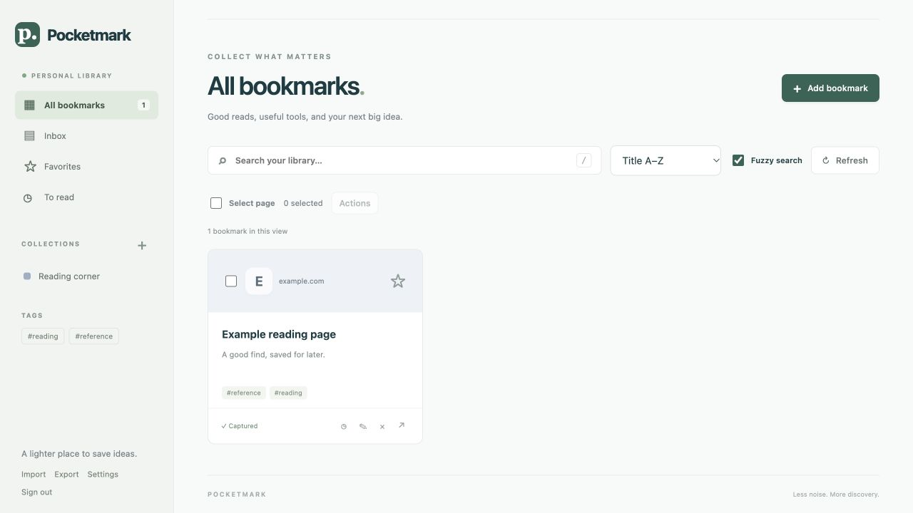

<p>
  
</p>

# Pocketmark

A personal bookmark manager built for low RAM usage: one Go process, SQLite and an embedded web interface. No external database or server-side browser.

[](https://github.com/theopoc/pocketmark/actions/workflows/ci.yml)
[](https://github.com/theopoc/pocketmark/releases)
[](https://github.com/theopoc/pocketmark/issues)



## Features

- Organize bookmarks with nested collections, tags, favorites and notes.
- Search bookmarks and saved page text.
- Save pages for offline reading, attach files and annotate text.
- Import JSON or browser bookmarks; sync with Floccus.
- Capture rendered pages and screenshots with the [browser extension](extension/README.md).
- Use the mobile web interface or compatible third-party clients ([tested clients and limits](docs/REAL_CLIENTS.md)).

Personal use only: collaboration, public sharing, SSO and automations are outside the supported scope.

## Quick start

Use Docker Compose, or [download a Linux binary](docs/RELEASE_INSTALL.md).

With Git and Docker Compose installed:

```sh
git clone https://github.com/theopoc/pocketmark.git
cd pocketmark
docker compose up --build -d
docker compose exec pocketmark cat /data/access-token
```

Open [http://127.0.0.1:8090](http://127.0.0.1:8090) and sign in with the token. Data persists in a Docker volume. Compose sets a 128 MiB memory limit; see [measured RAM usage](docs/BENCHMARK.md) for workload results.

For HTTPS access, set `POCKETMARK_ORIGIN` to your public URL. See the [guide](docs/GUIDE.md#configuration) for configuration.

## Development

Requires Go (see `go.mod`), a C compiler and Make. Node.js and Python 3 are also required for checks and tests.

Build and run locally:

```sh
make build
./bin/pocketmark
# In another terminal:
cat ./data/access-token
```

Run the checks before contributing:

```sh
make check
make test
make test-extension
```

## Documentation

- [User guide](docs/GUIDE.md) — configuration, migration and full backups.
- [Browser extension](extension/README.md) — installation and capture tools.
- [API](docs/API.md) — endpoints and request limits.
- [Development and CI](docs/CI.md) — checks and releases.
