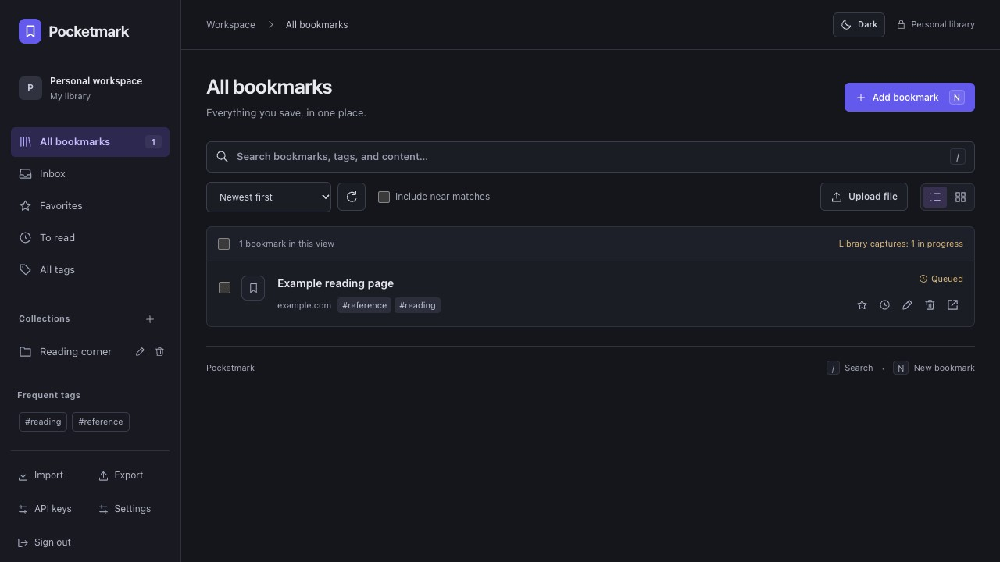

<p>
  
</p>

# Pocketmark

A personal bookmark manager built for low RAM usage: one Go process, SQLite and an embedded web interface. No external database or server-side browser.

[](https://github.com/theopoc/pocketmark/actions/workflows/ci.yml)
[](https://github.com/theopoc/pocketmark/releases)
[](https://github.com/theopoc/pocketmark/issues)



## Features

- Organize bookmarks with nested collections, tags, favorites and notes.
- Search bookmarks and saved page text.
- Save pages for offline reading, attach files and annotate text.
- Import JSON or browser bookmarks; sync with [Floccus](#floccus).
- Save bookmarks and capture rendered pages, screenshots or PDFs with the [Pocketmark Chrome extension](#pocketmark-chrome-extension).
- Use the mobile web interface; sync browser bookmarks with Floccus over WebDAV.

Personal use only: collaboration, public sharing, SSO and automations are outside the supported scope.

## Quick start

Use Docker Compose, or [download a Linux binary](docs/RELEASE_INSTALL.md).

With Git and Docker Compose installed:

```sh
git clone https://github.com/theopoc/pocketmark.git
cd pocketmark
docker compose up -d
```

Open [http://127.0.0.1:8090](http://127.0.0.1:8090) and create your personal account. On later visits, sign in with your username and password. Data persists in a Docker volume. Compose sets a 128 MiB memory limit; see [measured RAM usage](docs/BENCHMARK.md) for workload results.

For HTTPS access, set `POCKETMARK_ORIGIN` to your public URL. See the [guide](docs/GUIDE.md#configuration) for configuration.

## Integrations

### Pocketmark Chrome extension

1. Follow the [manual installation instructions](extension/README.md#install-and-connect) to load the Pocketmark extension in Chrome.
2. Sign in to Pocketmark, open **Settings → API keys**, create a dedicated key and copy it immediately; it is shown only once.
3. Open the extension on a regular HTTP(S) page. Under **Connection settings**, enter your Pocketmark origin, such as `https://bookmarks.example.com` (without `/api` or `/dav/`), and the key. Click **Connect** and approve server access. If Chrome closes the popup, reopen it to finish connecting.
4. Choose a collection, edit the title or tags, optionally select formats under **Attach captures**, then save.

Captures are off by default. Rendered HTML, visible PNG, full-page PNG and PDF can be selected independently. Work continues after the popup closes; failed uploads retain captured files locally for manual retry. See [permissions, recovery and limits](extension/README.md). Linkwarden extensions and mobile clients are no longer supported.

### Floccus

Floccus synchronizes browser bookmarks and nested folders with Pocketmark in both directions, including edits, moves and deletions. Create a separate key for each client: sign in to Pocketmark, open **Settings → API keys**, create a named key and copy it immediately; it is shown only once.

Configure the **WebDAV** backend in Floccus:

| Setting | Value |
| --- | --- |
| Server URL | `https://bookmarks.example.com/dav/` |
| Username | Any descriptive username |
| Password | Dedicated Pocketmark API key |
| File format / file | XBEL / `bookmarks.xbel` |
| File encryption | Disabled |

1. Add a **WebDAV** account in Floccus with the settings above. Use HTTPS outside localhost. The Linkwarden API backend has been removed.
2. Select the local browser bookmark folder to synchronize. Leave file encryption disabled so Pocketmark can read the XBEL tree.
3. Back up your library before the first sync, then download/merge the existing server bookmarks. Synchronization propagates deletions too; an incomplete uploaded tree can remove server bookmarks.
4. Run a manual synchronization and check both libraries before enabling automatic synchronization in Floccus.

Use the API key rather than your Pocketmark account password. Bookmark order is preserved. Existing bookmarks retain Pocketmark notes, tags, captures and annotations; standalone uploaded files are excluded from XBEL synchronization and remain in Pocketmark.

WebDAV was previously verified with unmodified **Floccus 5.11.1**, including synchronization after a server restart. See [tested client workflows and limits](docs/REAL_CLIENTS.md) and [Floccus data semantics](docs/FEATURES.md#floccus-setup-and-data-semantics). Synchronization runs in Floccus; Pocketmark adds no background sync process.

## Development

Requires Go (see `go.mod`), a C compiler and Make. Node.js and Python 3 are also required for checks and tests.

Build and run locally:

```sh
make build
./bin/pocketmark
# In another terminal:
cat ./data/access-token
```

Run the checks before contributing:

```sh
make check
make test
make test-extension
```

## Documentation

- [User guide](docs/GUIDE.md) — configuration, migration and full backups.
- [Browser extension](extension/README.md) — installation and capture tools.
- [API](docs/API.md) — endpoints and request limits.
- [Observability](docs/OBSERVABILITY.md) — JSON logs, authenticated metrics and optional OpenTelemetry traces.
- [Development and CI](docs/CI.md) — checks and releases.
