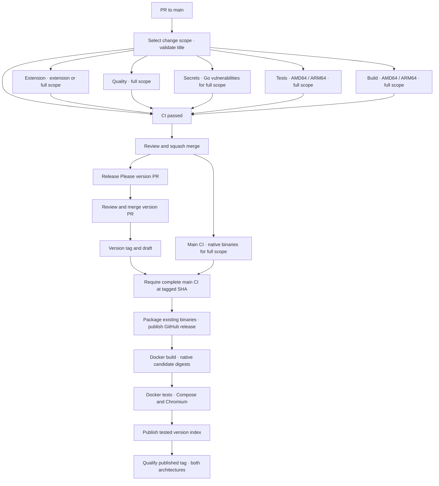

# CI and release

GitHub Actions runs on pushes to `main`, pull requests targeting `main` (including title edits), manual dispatch, and every Monday at 05:23 UTC. The weekly run uses the complete suite to detect new vulnerability advisories and runner/tool drift without a source change; it never calls the release workflow. Scheduled runs start only after this configuration reaches the default branch; GitHub can delay them or disable them after 60 days of inactivity in a public repository. Release Please also runs on pushes to `main`, preparing a version PR or handing a merged version PR to the release pipeline. A release waits for the successful complete main CI at the tagged commit and reuses its native binaries. Docker images are built only for a published release. Every selected gate must pass; failed or cancelled jobs and unexpected skips fail the final `CI passed` check.

| Phase | Checks and outputs |
| --- | --- |
| Selection and title | Inspect the complete Git change range and validate the Conventional Commit PR title. |
| Quality | Formatting/vet, module checksums and tidy drift, syntax, actionlint and GoReleaser configuration, for complete runs. |
| Security | Redacted full-history Gitleaks scan on every run; reachable Go vulnerabilities with the SQLite tags for complete runs. |
| Tests, AMD64 and ARM64 | Native Go race tests with coverage, embedded UI regressions, release-tool tests and actual workflow expression regressions, for complete runs. |
| Extension | JavaScript syntax, extension regressions and installable ZIP validation, once on AMD64 when extension or shared inputs change. |
| Build, AMD64 and ARM64 | Separate native musl builds produce static binaries and build metadata, retained for 90 days as release inputs. |
| CI passed | Requires selection/title and security to succeed, plus every job selected for the change scope. |
| Docker release | Build native candidates by digest, test Compose and Chromium on both architectures, publish the tested version index, then qualify the published tag. Runs only for a published stable release. |

## Checks by change scope

CI always starts so the required `CI passed` check can complete on documentation PRs. Skipping the entire workflow with `paths-ignore` would leave a required check pending ([GitHub path-filter semantics](https://docs.github.com/en/actions/reference/workflows-and-actions/workflow-syntax#onpushpull_requestpull_request_targetpathspaths-ignore)). The dependency-free selector in `scripts/ci_changes.py` uses a full Git checkout, the PR merge-base diff or the complete push range, with NUL-delimited paths and rename detection disabled. It includes deletions and both sides of renames and has no API file-list limit. Missing/unavailable ranges and empty diffs select the complete suite.

| Changed files | Jobs selected, in addition to title/selection, secrets and `CI passed` |
| --- | --- |
| Root Markdown except `CHANGELOG.md`; Markdown, JSON and image evidence under `docs/` except `docs/RELEASE_INSTALL.md`; `.github/pull_request_template.md` | None: no Go toolchain, vulnerability scan, tests or builds. |
| Only `extension/`, optionally alongside the documentation above | Dedicated Extension job; no Go toolchain, server tests or native builds. `extension/README.md` is packaged, so it also runs this job. |
| Server, embedded UI/API documentation, dependencies, workflows, scripts, Makefile, release metadata, installation instructions, mixed server/extension changes or any unrecognized path | Complete suite, including Extension. |
| Manual dispatch or weekly schedule | Complete suite regardless of changed files. |

Extension checks remain a separate job in the same workflow, so one required aggregate can enforce both scopes without cross-workflow status coordination. They run once rather than once per server architecture. Shared inputs deliberately select all checks to cover server/extension compatibility. No product code, server memory use or release authorization changes.

Documentation-only and extension-only main runs do not retain server binaries. Release Please version metadata always selects the complete suite, preserving tested native artifacts at the exact release revision. Publication still rejects incomplete main runs or missing artifacts; a manual dry run at a documentation-only revision cannot reuse binaries from another commit. Release Please continues to inspect main pushes so release history and pending changes remain coherent.

Actions use full commit SHAs; tool modules, pre-commit hooks and the Gitleaks engine are version-pinned. PR/main CI has read-only permissions and never builds or publishes Docker images. Superseded branch runs are cancelled; main runs are retained because a release may need their binaries. Coverage, container evidence and release bundles are retained for seven days.

The separate Dependabot workflow only reads verified PR metadata before enabling auto-merge; it never executes PR code. Release Please can maintain version PRs/drafts and dispatch CI on its branch. GitHub publication receives `contents:write`; only release image build/index jobs receive `packages:write`. Publication uses the short-lived `GITHUB_TOKEN` and needs no personal token or additional registry secret.

The module toolchain baseline is declared in `go.mod`; the Docker builder version is declared separately in `Dockerfile`. Review their alignment when either changes and keep both toolchains patched. A numerically newer Go minor version does not imply its patch level contains every security fix. Govulncheck remains blocking rather than suppressing standard-library reports.

The deterministic container smoke test does not depend on public websites. The separate live-page workload in [BENCHMARK.md](BENCHMARK.md) measures RAM and external capture behavior; CI smoke checks are not performance measurements or native mobile UI tests. Repository runtime data, tool sessions, downloaded clients, build output and raw HTTP traces are ignored. Maintained synthetic screenshots and summarized benchmark evidence remain in `docs/`.

## Local pre-commit hooks

Install [pre-commit](https://pre-commit.com/#install), then enable the checked-in configuration:

```sh
pre-commit install
pre-commit run --all-files
```

Hooks run on staged files before each commit. The first run creates isolated hook environments; the Gitleaks hook builds its pinned engine using Go, without a separate global Gitleaks installation. Go and Node.js must be on PATH. Formatting hooks update files; review and stage their changes before retrying the commit.

| Hook | Reason |
| --- | --- |
| Large files (1 MiB for newly added files) | Catch accidental binaries and data exports; existing curated screenshots remain valid. |
| Merge and case conflicts | Reject unresolved merges and paths that collide on macOS/Linux. |
| JSON, YAML and TOML syntax | Validate manifests, workflows and tooling configuration without reformatting them. |
| Final newline and trailing whitespace | Keep diffs readable; preserve Markdown hard line breaks. |
| Gofmt and JavaScript syntax | Fast checks for the Go server, embedded UI and extension, without new frontend dependencies. |
| Gitleaks | Scan the staged diff for secrets with redacted output before they enter history. |

Full Go vet/race tests, extension tests, builds, actionlint and container tests stay in CI to keep commits fast and avoid requiring Docker or release tools for every edit. Hooks complement those gates and do not replace them. Run `pre-commit autoupdate` deliberately and review version changes.

CI uses the [official Gitleaks action](https://github.com/gitleaks/gitleaks-action), pinned to a full commit SHA, with engine version 8.30.1. It selects the action's `workflow_dispatch` scan mode explicitly for every caller, scanning the complete checked-out history at the selected ref rather than the event's PR/push range. Comments, SARIF uploads and summaries are disabled; output remains redacted and repository permissions remain read-only. Personal-account repositories do not require a Gitleaks action license; organization-owned repositories require `GITLEAKS_LICENSE`.

## Development and merge policy

Use short-lived branches from current `main`, one focused PR per change, and a Conventional Commit title such as `fix(api): reject invalid tokens`. CI validates the title on PR creation, new commits, reopening and metadata edits. The squash commit drives Release Please, so preserve that validated title when merging. A `!` requests a breaking release. Avoid long-lived `develop` or release branches for this single-maintainer project.

The repository settings observed on 2026-10-23 allow only squash merges and delete merged branches. This audit set `squash_merge_commit_title` to `PR_TITLE`, so GitHub proposes the validated PR title even for a one-commit PR; the maintainer can still edit it at merge time. The active **Protect main** ruleset requires a PR, resolved review threads, linear history, and `CI passed` from the GitHub Actions app (integration ID 15368), with the branch up to date. It blocks deletion and force pushes, with no bypass actors. Zero required human approvals is intentional for personal maintenance; review the diff and evidence before merging. A repository setting, rather than workflow YAML, enforces this policy. Do not merge on an earlier commit's green checks. [GitHub required-check semantics](https://docs.github.com/en/pull-requests/how-tos/merge-and-close-pull-requests/troubleshooting-required-status-checks).

Merging remains an explicit maintainer action except for eligible Dependabot minor and patch PRs described below. The PR template records resulting behavior, compatibility impact, checks and secret scanning. For a normal PR, merging updates `main` and may update a Release Please PR. Merging the generated version PR authorizes publication: review its version and notes before doing so. Release tags matching `v*` cannot be updated or deleted under the separate active tag ruleset.

Dependabot checks Actions, Go modules and Docker base images weekly, with at most two open **version-update** PRs per ecosystem (security-update limits are separate). Each ecosystem groups minor and patch updates; major updates remain separate and require manual merge. Keep Actions pinned to full SHAs. Align changes to the Go directive and Docker compiler tag manually, and review the pinned tool versions embedded in `go run`, action inputs and download URLs: these are not all covered by Dependabot. A Docker update passing syntax checks alone is insufficient. [Dependabot options](https://docs.github.com/en/code-security/reference/supply-chain-security/dependabot-options-reference).

Enable the repository's **Allow auto-merge** setting while retaining the active **Protect main** ruleset above. `dependabot-auto-merge.yml` handles PR creation, new commits, reopening and readiness for review. It only accepts non-draft PRs opened by `dependabot[bot]` from this repository. The SHA-pinned official `dependabot/fetch-metadata` action verifies Dependabot's signed commits; verification is never disabled. Its `update-type` is the highest semver change across the PR, so any major update in a group prevents automatic merge. Only explicit `version-update:semver-minor` and `version-update:semver-patch` metadata enable squash auto-merge; unknown or missing metadata fails closed. [Fetch Metadata documentation](https://github.com/dependabot/fetch-metadata/tree/v3.1.0).

The workflow uses `gh pr merge --auto --squash --match-head-commit` with the event's head SHA. GitHub waits for the complete `CI passed` gate, an up-to-date branch and resolved review threads; it has no ruleset bypass. Failed, skipped, cancelled or pending CI cannot authorize merge. Keep `CI passed` required from the GitHub Actions app with strict branch updates and no bypass actors: the workflow relies on this server-side enforcement. Existing open PRs are evaluated on their next supported PR event after the workflow reaches `main`. As with other operations performed using `GITHUB_TOKEN`, the resulting merge does not trigger push-based CI or Release Please; subsequent eligible pushes to `main` pick up the dependency commits. The PR's complete CI still gates its merge. CI regression tests evaluate the actual eligibility and scope expressions, Git change ranges, and the aggregate gate's failure/skip/cancellation behavior.

The title check uses PR-event metadata. Dispatch, push and scheduled CI runs validate source rather than a PR title; these runs cannot attest to PR metadata. Metadata edits rerun selection and validate the new title. The file scope still comes from the entire PR, so a code PR retains the complete suite even when only its title is edited. For a future busy repository, consider an independent required metadata check and `merge_group` support before enabling a merge queue.

See [the sourced pipeline research](CI_RESEARCH.md) and [the scored audit](CI_AUDIT.md) for rationale, evidence and remaining limitations.

## Reproduce locally

Requirements: Go as declared by `go.mod`, a C compiler, Node.js 24, Python 3, `make`, and Docker Compose for the container test.

```sh
make check
make test
make test-extension
python3 -m unittest discover -s scripts -p 'test_*.py' -v
make build
make release-check
docker build -t pocketmark:ci .
npm ci --prefix e2e --ignore-scripts --no-audit --no-fund
./e2e/node_modules/.bin/playwright install --with-deps chromium
python3 scripts/smoke_docker.py --image pocketmark:ci --browser
```

The browser dependency is pinned and locked under `e2e/`; it is test tooling only and is not copied into the application image. The browser runs on the CI runner, outside the server's 128 MiB container limit. These Chromium desktop journeys are separate from extension regressions and do not qualify Firefox, Safari, native mobile clients or full accessibility.

Extension regressions and package validation run in the dedicated Extension job for extension-only and complete runs. Container and Chromium journeys run during release; complete PR/main CI covers Go, embedded UI, extension and release-tool regressions without Docker.

The release expression regression checks use `@actions/expressions` only as a temporary CI/test tool; it is not an application or frontend dependency. They read the expression directly from the workflow and cover missing/empty PR outputs after a version PR is merged, ordinary opened PRs, and malformed output. Reproduce them locally with:

```sh
npm install --prefix /tmp/pocketmark-release-expressions --no-save --no-package-lock \
  --ignore-scripts --no-audit --no-fund @actions/expressions@0.3.61
ACTIONS_EXPRESSIONS_PATH=/tmp/pocketmark-release-expressions/node_modules/@actions/expressions/dist/index.js \
  node --test scripts/test_release_expressions.mjs
```

Release tooling uses **GoReleaser OSS 2.18.3**, pinned in Actions. No Pro license or additional secret is required. Linux binaries require `musl-gcc` and matching native architecture because SQLite uses CGO. The native CI jobs compile and test them; GoReleaser's OSS `meta` archives then package those exact binaries with installation instructions. It generates the extension ZIPs and `SHA256SUMS` too. The single extension ZIP contains nine explicitly named production files, including its background worker, and declares `debugger` access. Tests and local data are never globbed into release archives.

For a local packaging rehearsal, download the `linux-amd64` and `linux-arm64` CI artifacts into `artifacts/linux-amd64/` and `artifacts/linux-arm64/`, retaining their executable and `.buildinfo.txt` files. With GoReleaser 2.18.3 installed, run:

```sh
make release-snapshot
python3 scripts/verify_release.py --directory dist --metadata artifacts \
  --commit "$(git rev-parse HEAD)" --output artifacts/verified
goreleaser release --snapshot --skip=archive --clean --config .goreleaser-publish.yaml
```

Use artifacts built from the current clean commit; verification rejects another revision. The output directory must be new. `artifacts/verified/` contains only the six approved assets, separate from GoReleaser's temporary metadata in `dist/`.

## Publish a version

The normal release entry point is **merging the Release Please version PR**. On each push to `main`, Release Please reads Conventional Commits and opens or updates a PR containing `CHANGELOG.md`, `version.txt` and `.release-please-manifest.json`. `feat:` requests a minor bump, `fix:` a patch bump, and `!` or a `BREAKING CHANGE:` footer a major bump. Commits such as `docs:` and `ci:` alone do not request a release. With no previous published tags/releases, the first version is `0.1.0`. The Chrome extension keeps its independent manifest version.

Review and squash-merge the version PR when ready to publish; keep its generated title and release metadata. Release Please creates an immutable `vMAJOR.MINOR.PATCH` tag and a **draft** GitHub release. The remaining jobs run directly in the same Release workflow: they do not rely on the tag/release events suppressed by `GITHUB_TOKEN`. The workflow validates the tag and ancestry, waits for the entire main CI run at that exact commit (including the separate test and build jobs), downloads that run’s tested executables with digest validation, and runs `.goreleaser.yaml` to package them. It accepts neither PR CI nor an incomplete main run. Release packaging reuses the downloaded binaries without rebuilding them; the container workflow builds Docker separately after GitHub publication. Verification checks checksums, archive contents, executable permissions, ELF architecture, clean source revision and extension permissions before retaining the publication bundle.

Only then does the write-enabled job recheck that bundle and require a missing release or an empty stable draft targeting the verified commit. It runs `.goreleaser-publish.yaml` to upload those same files and publish the release, retaining Release Please's notes. This separate configuration disables builds and checksums; `--skip=archive` also prevents repackaging. GitHub assets are not rebuilt during publication, tags are not moved and published releases are not overwritten. After GitHub publication succeeds, the workflow calls the container workflow below. An explicitly requested manual tag push still follows the same validation/publication path.

Enable **Settings → Actions → General → Workflow permissions → Allow GitHub Actions to create and approve pull requests** for Release Please to open its version PRs. The workflow never approves or merges PRs. The Release Please job explicitly dispatches read-only CI on the PR branch after creating/updating it. This avoids depending on automatic PR-event execution or an approval-required bot run; `workflow_dispatch` is an explicit exception to the usual `GITHUB_TOKEN` event restrictions ([GitHub documentation](https://docs.github.com/en/actions/how-tos/write-workflows/choose-when-workflows-run/trigger-a-workflow)). These checks run at the PR head revision and satisfy the normal CI requirement without a PAT.

If verification fails, the release stays a draft and the container is not published. Rerun the failed jobs after resolving the failure. If the workflow itself needed a fix, use the corrected workflow to resume the existing immutable tag:

```sh
gh workflow run release.yml --repo theopoc/pocketmark --ref main -f tag=v0.1.0 -F publish=true
```

This rechecks the successful main CI and packages its retained artifacts at the tag’s exact revision before publishing. It does not move the tag or package the corrected workflow's current source. To rehearse that recovery without publication, omit `publish=true`. If publication partially uploaded files, inspect and remove those draft assets before retrying; the guard deliberately rejects non-empty drafts. For a failure after GitHub publication, rerun the container jobs or use the backfill dispatch below.

Expected assets are Linux AMD64/ARM64 `.tar.gz` files, their `.buildinfo.txt` files, the Chrome extension ZIP, and `SHA256SUMS`. Binary archives are static; extensions are unpacked/loaded manually. [Binary installation instructions](RELEASE_INSTALL.md).

Manually dispatching **Release** defaults to complete verification and assembly as a **dry run**, on a commit belonging to `main`. Both GoReleaser configurations are exercised in snapshot mode, which disables publication. Its `verified-release` artifact contains the same asset set and checksums. GitHub and container publication stay skipped even when a manual run targets a tag, unless the explicit `publish` input is enabled with a stable tag. No product version is published merely by committing or pushing `main`.

## GHCR images

Docker builds occur only in `container-release.yml`, after GitHub release publication or an explicit retry for an already published stable release. The workflow validates the immutable tag, ancestry on main and successful complete main CI with retained binaries. Ordinary main pushes, PRs, the weekly CI and release dry runs never build Docker.

The release image flow has separate build and test phases. Native AMD64/ARM64 builders push untagged candidate digests. Fresh native test jobs pull those exact digests and run hardened Compose smoke tests plus Chromium journeys. Only when both pass does publication create `vMAJOR.MINOR.PATCH` from those tested digests. The published tag is then pulled and qualified on both architectures: exact index digest, platform, source revision, version label, health/authentication, FTS5, SSRF filtering, backup, restart persistence and anonymous-access denial. No `latest` or moving minor alias is published.

The OCI revision is the release source SHA and the OCI version is `vMAJOR.MINOR.PATCH`. Images are built once per release attempt; no SHA-tag promotion or image evidence from main CI is involved. Existing version tags must already contain the same platform digests; differing content is never replaced. A retry that produces different bytes therefore fails safely instead of overwriting an existing version.

Main binaries are retained for 90 days, subject to repository retention policy. Missing/expired binaries or a failed main CI block publication rather than silently rebuilding release archives. Rerun the original main CI for recoverable failures. Build attestations are disabled so the index contains exactly two runnable platforms; this pipeline does not claim signed provenance or an SBOM. Untagged candidates may remain after a failed release attempt.

GHCR package visibility is separate from the public source repository and must remain private; consumers need authenticated read access. These workflows publish artifacts and do not deploy to a server. Release calls the container workflow directly because publication using `GITHUB_TOKEN` does not trigger another workflow's `release:published` event. [GitHub event semantics](https://docs.github.com/en/actions/how-tos/write-workflows/choose-when-workflows-run/trigger-a-workflow).

To retry the container workflow for an already published release without moving its Git tag or changing its GitHub assets:

```sh
gh workflow run container-release.yml --repo theopoc/pocketmark --ref main -f tag=v0.3.0
```

This dispatch builds and tests real release candidates and can publish the version image; it is not a dry run. Authenticated clients can then pull it:

```sh
docker pull ghcr.io/theopoc/pocketmark:v0.3.0
```

### Development and publication flow


