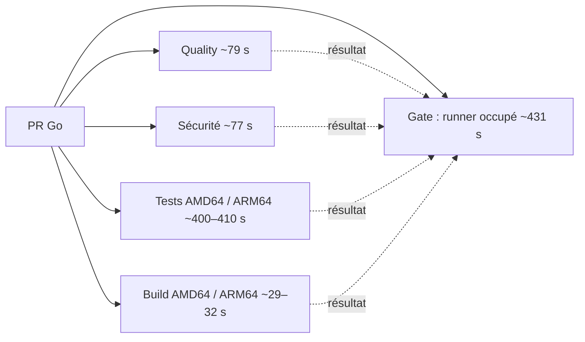
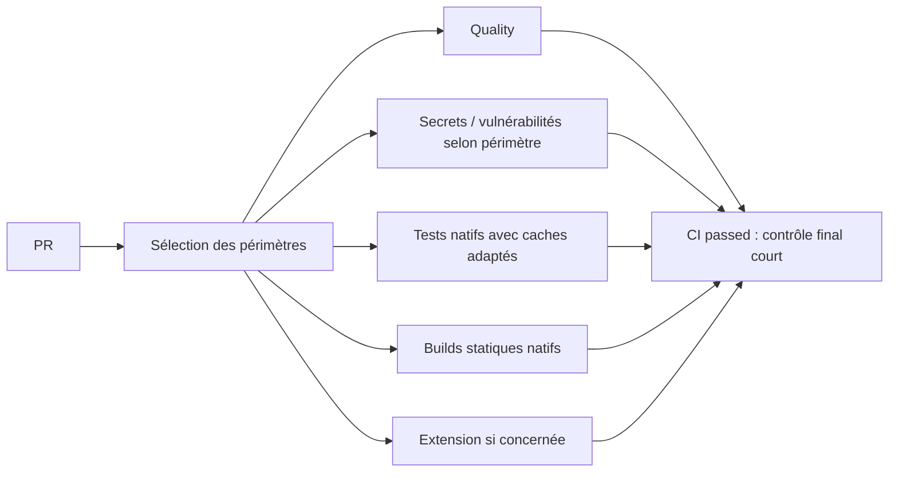

# Audit des durées CI — 31 octobre 2026

La CI Go courante prend **6 min 56,5 s en médiane**. Les deux jobs de tests dominent ; le build des exécutables, l'extension et les contrôles syntaxiques ne sont pas le premier levier. Priorité proposée : améliorer le cache de compilation, profiler et alléger les fixtures serveur, puis remplacer l'attente active du gate. Objectif expérimental : **3–4 minutes**, à valider, sans retirer CGO, les tests race ni une architecture.

## Périmètre et méthode

Audit de la branche distante à `5a58294066b65d1106307732deac56ff2aefaf82`. La copie locale initiale était à `194613077ae3c9e5a542cebda37769063f95c3f0` ; sa CI ne reflétait pas les dernières séparations des workflows. Le fichier `compose.yaml` comportait une modification locale préexistante, laissée intacte. Ce rapport ne change aucun workflow ni comportement applicatif.

Collecte : liste des 100 dernières exécutions via l'API GitHub, puis jobs et étapes des 36 dernières exécutions réussies parmi CI, Required CI, Extension CI, Release et Container release. Les données collectées couvrent le 31 octobre, de 02:28 à 12:06 UTC pour les départs. Les logs de deux jobs de tests du dernier push main et du gate manuel ont été examinés. Les mesures sont des observations ponctuelles, pas un benchmark contrôlé.

L'échantillon principal contient **6 exécutions CI à six jobs**, correspondant à l'organisation actuelle : 41196499490, 41197027523, 41197563382, 41199019372, 41199584382 et 41199604792. Les anciennes configurations à sept/neuf jobs restent séparées. Les runs `action_required`, échoués ou annulés ne servent pas à calculer les durées de succès ; cela ne mesure donc ni la fiabilité ni le coût global des tentatives. La collecte prend la dernière tentative disponible.

Durée du workflow : `updated_at − created_at` pour ces runs terminés, approximation du délai utilisateur. Durée du job : `completed_at − started_at`. Coût cumulé : somme des durées des jobs, sans arrondi de facturation ; ce n'est pas un prix. Les étapes incluent parfois plusieurs commandes et ne permettent pas toujours de séparer compilation et exécution. Aucun P95 significatif n'est revendiqué avec six runs.

Sources reproductibles : [API des runs](https://api.github.com/repos/theopoc/pocketmark/actions/runs?per_page=100), [jobs du dernier main](https://api.github.com/repos/theopoc/pocketmark/actions/runs/41199584382/jobs?per_page=100), [workflow CI audité](https://github.com/theopoc/pocketmark/blob/5a58294066b65d1106307732deac56ff2aefaf82/.github/workflows/ci.yml).

## Ce qui prend réellement du temps

| Job / mesure | Médiane | Min–max | Interprétation |
| --- | ---: | ---: | --- |
| Workflow CI complet | 6 min 56,5 s | 6 min 50–7 min 08 | Délai avant fin de CI, hors gate indépendant |
| Tests ARM64 | 6 min 50 s | 6 min 37–6 min 59 | Premier goulot régulier |
| Tests AMD64 | 6 min 40 s | 4 min 13–7 min 03 | Également critique, forte variation |
| Quality | 1 min 19 s | 59 s–1 min 26 | Principalement `make check` / vet |
| Secrets et vulnérabilités | 1 min 16,5 s | 19 s–1 min 22 | Principalement govulncheck |
| Build AMD64 | 31,5 s | 18–93 s | Pas le chemin critique actuel |
| Build ARM64 | 28,5 s | 21–31 s | Pas le chemin critique actuel |

L'étape `Race tests and coverage` représente une médiane de **391,5 s sur ARM64** et **383,5 s sur AMD64**. Elle exécute `go test -race -p 1 -count=1 -covermode=atomic` puis les tests de l'UI embarquée. Le coût cumulé des six jobs est **16 min 54,5 s en médiane**, avec exécution parallèle. Les médianes individuelles ne doivent pas être additionnées pour reconstruire la médiane du total.

Sur les trois PR observées avec le gate séparé, `Required CI` prend 7 min 14–16 s écoulées ; son job occupe un runner pendant **430–431 secondes**, dont **425–426 secondes dans l'action d'attente**. Le surcoût après fin du workflow CI est seulement 8–24 secondes : ces sept minutes se chevauchent avec les tests, elles ne s'ajoutent pas au délai utilisateur. Elles ajoutent en revanche environ sept minutes de runner par PR complète. [Exemple CI](https://github.com/theopoc/pocketmark/actions/runs/41199019372), [gate correspondant](https://github.com/theopoc/pocketmark/actions/runs/41199019364).

Les trois jobs Extension séparés observés prennent **7, 8 et 13 secondes**. Les déplacer encore ou multiplier les caches npm ne cible pas le coût dominant. Leur séparation et les filtres docs/extension existent déjà sur main. [Workflow extension audité](https://github.com/theopoc/pocketmark/blob/5a58294066b65d1106307732deac56ff2aefaf82/.github/workflows/extension.yml).

## Deux causes à traiter avant de multiplier les jobs

### Cache restauré, mais compilation encore coûteuse

Les logs du [job ARM64](https://github.com/theopoc/pocketmark/actions/runs/41199584382/job/124532550139) et du [job AMD64](https://github.com/theopoc/pocketmark/actions/runs/41199584382/job/124532550176) montrent un cache exact restauré, puis `not saving cache` en fin de job. Le cache AMD64 fait environ 92 MiB. Le cache existe déjà ; proposer seulement d'activer `setup-go` serait inutile.

La clé du `setup-go` épinglé dépend de l'OS, architecture, image runner, version Go et hash des dépendances. Elle n'inclut ni le mode race/couverture/musl ni la révision source. Quality, security, test et build d'une même architecture peuvent donc concourir pour la même clé. Une archive gagnante ne s'enrichit plus lors des hits exacts. Le code Go sait distinguer les variantes à l'intérieur du cache ; le problème est la disponibilité et le renouvellement de ces entrées, pas une confusion de binaires. [Implémentation exacte de la clé](https://github.com/actions/setup-go/blob/b7ad1dad31e06c5925ef5d2fc7ad053ef454303e/src/cache-restore.ts), [cache Actions](https://github.com/actions/cache/blob/main/README.md).

Sur ARM64, environ **110 secondes** séparent le début de `go test` du résultat du premier paquet, lequel annonce seulement 2,468 secondes d'exécution. Sur AMD64, environ **73 secondes**, pour 1,838 seconde d'exécution. C'est un indice fort de compilation/préparation répétée, pas une mesure isolée de la compilation SQLite. On ne peut pas attribuer toute cette attente au seul CGO sans trace complémentaire.

Proposition : désactiver le cache automatique si on lui substitue un cache explicite ; séparer `GOMODCACHE` et `GOCACHE`. Pour `GOCACHE`, utiliser OS/image, architecture, Go, compilateur C, tags et mode (`race-cover`, `vet`, `musl-static`) dans le préfixe ; ajouter une révision ou une rotation bornée pour l'enregistrement, avec restauration par préfixe compatible. Écrire le cache de référence depuis main ; restaurer sur les PR, avec politique de rétention maîtrisée. Ne pas supprimer `-count=1` : il force l'exécution des tests, pas la recompilation systématique des dépendances.

Gain à expérimenter : **environ 1 minute sur le chemin critique**, éventuellement davantage. Les 73/110 secondes observées donnent un budget à investiguer, pas une promesse de récupération intégrale. Mesurer le temps de téléchargement et de sauvegarde ; un cache trop gros peut annuler le bénéfice.

### Le paquet serveur et ses fixtures

Sur le dernier main, le paquet `internal/server` annonce **271,491 s sur ARM64** et **153,053 s sur AMD64**. Les quatre autres paquets ayant des tests totalisent seulement environ **12,8 s / 9,9 s** d'exécution respectivement. Une division des jobs uniquement par paquet laisserait donc un shard très déséquilibré.

La lecture des tests révèle une piste précise : `fixtureOwnerCookie` calcule un hash de mot de passe pour créer un compte dans les tests de routes, même quand ces tests créent directement une session. `passwordLogin` calcule un hash puis fait une vraie connexion. Le hash de production utilise **600 000 itérations PBKDF2**. Le coût CPU est intentionnel pour la sécurité ; sa part exacte dans les 271 s n'est pas encore profilée. [Fixtures](https://github.com/theopoc/pocketmark/blob/5a58294066b65d1106307732deac56ff2aefaf82/internal/server/server_test.go), [fonction de dérivation](https://github.com/theopoc/pocketmark/blob/5a58294066b65d1106307732deac56ff2aefaf82/internal/server/account.go).

Proposition : mesurer avec `go test -json` et profil CPU ciblé, puis réutiliser un couple sel/hash synthétique précalculé dans les fixtures de routes qui n'exercent pas le mot de passe. Garder une base temporaire et des sessions indépendantes pour chaque test, ainsi que les vrais parcours login/MFA/réauthentification et leurs paramètres de production. Ne pas diminuer les itérations de production et ne pas introduire un réglage global de sécurité « spécial CI ».

Tester ensuite `-p 2` plutôt que `-p 1`, puis un parallélisme borné des tests réellement indépendants. `-p` agit entre paquets ; il ne parallélise pas automatiquement les tests du paquet serveur. `t.Parallel()` exige de vérifier les ressources/globales partagées et la pression mémoire. Le plafond théorique du seul chevauchement des durées d'exécution des autres paquets est ici de l'ordre de 13 s sur ARM64, hors compilation. [Documentation Go](https://pkg.go.dev/cmd/go#hdr-Testing_flags).

## Organisation recommandée

Conserver les responsabilités quality, sécurité, tests natifs, builds natifs et publication. La séparation tests/build permet déjà une exécution parallèle ; les fusionner ferait attendre le build derrière les tests. Conserver aussi Docker hors du chemin des PR ordinaires.

Pour simplifier les dépendances, proposition d'un workflow CI d'orchestration toujours déclenché sur PR, avec sélection explicite des périmètres et un gate final `needs` + `always()`. Les jobs restent parallèles après cette sélection. Le gate exige `success` pour chaque job sélectionné et accepte uniquement les exclusions de périmètre calculées ; un échec, une annulation ou un skip inattendu restent bloquants. Il n'occupe un runner qu'à la fin. Les chemins inconnus et les modifications des workflows/Makefile/scripts de validation déclenchent la suite complète.

Les anciens runs à neuf jobs démontrent qu'un gate via `needs` ne prenait que **2–4 secondes** après ses dépendances. Par rapport au polling actuel, économie attendue d'environ **7 minutes de runner par PR Go**, soit de l'ordre de **30 %** du total CI + gate observé. Le gain de délai n'est que de quelques secondes à quelques dizaines de secondes ; ne pas le présenter comme sept minutes de feedback gagnées.

Séparer le titre de PR dans un contrôle obligatoire propre, léger, permettrait de retirer `edited` des tests coûteux. Il faut changer les règles de protection en même temps et conserver la validation des titres Release Please : supprimer seulement l'événement réduirait la garantie. Le volume d'éditions de titres n'a pas été mesuré, donc aucun gain mensuel n'est chiffré.

Faire tourner les régressions Python/expressions une seule fois sur AMD64 est une simplification secondaire ; elles ne coûtent que quelques secondes dans les runs lus. Conserver les tests qui vérifient réellement ELF, CGO ou le comportement natif sur les deux architectures. Ne pas déplacer race ou ARM64 en nightly dans la première optimisation : ce serait une diminution de couverture pré-merge, pas une accélération à garantie constante.

Les nouveaux filtres méritent deux contrôles avant toute extension : les changements docs seuls ne passent actuellement par aucun des deux scans Gitleaks de CI/Extension ; et `extension.yml` n'inclut pas son propre chemin parmi ses déclencheurs. Le workflow Go se déclenche pour ce fichier, mais les tests extension de son job test sont exclus des événements PR. Un sélecteur central avec tests des périmètres évite ces asymétries. [CI](https://github.com/theopoc/pocketmark/blob/5a58294066b65d1106307732deac56ff2aefaf82/.github/workflows/ci.yml), [Extension CI](https://github.com/theopoc/pocketmark/blob/5a58294066b65d1106307732deac56ff2aefaf82/.github/workflows/extension.yml).

### Fiabilité du gate manuel

Observation à traiter avant d'utiliser sa vitesse comme indicateur : sur la même révision `10ddd6af89449bbb379872bea6874905a65d58a8`, le [gate manuel 41199606464](https://github.com/theopoc/pocketmark/actions/runs/41199606464) termine après **72 s**, alors que la [CI manuelle 41199604792](https://github.com/theopoc/pocketmark/actions/runs/41199604792) dure **414 s**. Le gate ne constitue donc pas, dans ce cas observé, une preuve d'attente de cette CI.

Le log montre une seule évaluation après le délai initial et `fail_on_missing_checks: false`. Le mécanisme d'exclusion des runs remplacés et le choix des checks doivent être vérifiés ; cet audit n'établit pas la cause exacte et ne prétend pas avoir démontré un contournement de protection de branche. Exiger des jobs explicitement attendus sur le bon SHA, y compris lors des dispatchs Release Please, serait plus robuste que simplement raccourcir le polling. [Gate courant](https://github.com/theopoc/pocketmark/blob/5a58294066b65d1106307732deac56ff2aefaf82/.github/workflows/ci-required.yml), [évaluation de l'action épinglée](https://github.com/wechuli/allcheckspassed/blob/1e77c91db5ec91faa94bf441f91b91327d269ab0/src/checks/checks.ts).

## Release et conteneurs : budget séparé

Une publication complète a été mesurée, [Release 41160834804](https://github.com/theopoc/pocketmark/actions/runs/41160834804), au commit `194613077a…` : **15 min 29 s**. Les autres runs Release récents ne font que préparer la PR de version (quelques dizaines de secondes), ils ne sont pas comparables.

| Phase de cette publication | Durée des jobs |
| --- | ---: |
| Attente de la CI main validée | 6 min 48 s |
| Packaging GoReleaser | 14 s |
| Publication GitHub | 16 s |
| Builds images AMD64 / ARM64 | 2 min 22 / 1 min 52 |
| Tests images AMD64 / ARM64 | 3 min 26 / 3 min 45 |
| Publication index | 24 s |
| Qualification du tag AMD64 / ARM64 | 43 / 45 s |

Ces durées se chevauchent dans les matrices ; elles ne s'additionnent pas toutes. Le packaging n'est pas le goulot. Le job d'attente consomme un runner pendant que CI travaille : à terme un déclenchement après succès de la CI source pourrait supprimer cette attente, mais la reprise manuelle, le bon SHA, l'origine de main et les permissions doivent rester vérifiés.

Les builds images recompilent le programme dans Docker alors que les binaires musl statiques validés sont disponibles. Proposition d'une cible Docker de release qui incorpore exactement ces binaires vérifiés, avec contrôles d'architecture et de métadonnées ; conserver une cible de build local depuis les sources. Les tests des digests candidats et la qualification du tag publié restent obligatoires. La divergence actuelle entre Go dans `go.mod` et la base Docker doit être résolue explicitement lors de cette évolution. [Dockerfile audité](https://github.com/theopoc/pocketmark/blob/5a58294066b65d1106307732deac56ff2aefaf82/Dockerfile), [workflow conteneurs](https://github.com/theopoc/pocketmark/blob/5a58294066b65d1106307732deac56ff2aefaf82/.github/workflows/container-release.yml).

Les étapes Buildx durent 94/122 s dans cette release, mais comprennent aussi cache et transfert registre : ce n'est pas entièrement du temps de compilation récupérable. L'installation du navigateur ne prend que 20/31 s, tandis que le test du digest prend 179/183 s. Profiler les phases du smoke/browser avant de cacher Chromium ou fragmenter la matrice. ARM64 est déjà natif, les caches BuildKit sont déjà distincts par architecture ; ne pas présenter ces pratiques comme des nouveautés à ajouter.

## Ce que font quatre projets Go populaires

Lecture de leurs workflows officiels au 31 octobre 2026 ; il s'agit de pratiques de configuration, sans comparaison de leurs temps avec Pocketmark. Les besoins et tailles de suites diffèrent. Les liens de branches sont évolutifs.

| Projet | Pratique observée | Application à Pocketmark et limites |
| --- | --- | --- |
| [Prometheus](https://github.com/prometheus/prometheus/blob/main/.github/workflows/ci.yml) | Suffixes de cache distincts (`more`, `386`, `upgrade`, `oldest`, etc.), jobs Go/UI séparés, assets UI construits et testés une fois puis réutilisés pour les builds ; matrices de build communes ou complètes selon l'événement. | Séparer les caches selon le travail et réutiliser les artefacts validés. Adapter cette dernière idée aux exécutables musl incorporés aux images. Sa grande matrice et son builder dédié ne sont pas nécessaires à Pocketmark. |
| [restic](https://github.com/restic/restic/blob/master/.github/workflows/tests.yml) | Matrice avec un job Linux race explicite ; cross-compilation divisée en trois lots ; agrégateur final `needs: [test, cross_compile, lint]`, `if: always()` et `alls-green`. | Le gate final par dépendances est directement pertinent. Le sharding n'est intéressant qu'après mesure de lots équilibrés. Limiter race à un seul environnement serait un changement de garantie ; la cross-compilation Go pure ne remplace pas les builds CGO natifs. |
| [Caddy](https://github.com/caddyserver/caddy/blob/master/.github/workflows/ci.yml) | Matrice Linux/macOS/Windows, tests `-short -race` avec couverture, build et smoke test du binaire, artefact avec compression désactivée. | Conserver le smoke du binaire et ajuster la matrice aux plateformes réellement distribuées. Ne pas recopier `CGO_ENABLED=0`, incompatible avec SQLite Pocketmark, ni `-short` sans identifier les tests exclus. La compression des petits artefacts n'est pas prioritaire ici. |
| [Hugo](https://github.com/gohugoio/hugo/blob/master/.github/workflows/test.yml) | Désactive le cache Go sous Windows car restauration et espace disque sont coûteux ; allège la suite Windows (sans race) et conserve des contrôles plus complets sous Linux. | Mesurer le coût du cache, plutôt que supposer qu'il accélère toujours. Les variantes de suite doivent avoir une justification de plateforme. Cela ne justifie pas de retirer les tests race ARM64 déjà pertinents pour Pocketmark. |

La leçon commune applicable n'est pas « plus de jobs » : c'est une séparation justifiée des coûts et des modes, des artefacts réutilisés, et une matrice proportionnée. Le cache différencié de Prometheus et l'agrégateur de restic correspondent aux deux problèmes observés ici. Pocketmark possède déjà les runners ARM natifs, l'annulation des PR dépassées, les outils épinglés et la séparation publication/validation ; les conserver.

## Plan d'expérimentation et critères d'acceptation

1. Instrumenter les tests avec JSON et un résumé des paquets/tests les plus lents ; relever version runner, cache hit, taille du cache et mode de compilation. Les traces brutes restent hors dépôt.
2. Corriger séparément le cache, puis les fixtures identifiées par le profil ; comparer avant/après sur le même matériel et une révision applicative équivalente, cache froid puis chaud. Conserver race, couverture, tags SQLite et `-count=1`.
3. Réorganiser le gate et les périmètres dans une PR distincte ; tester docs seuls, extension seule, Go, fichiers mixtes, workflow seul, titre seul, dispatch Release Please, checks absents/annulés/échoués et SHA modifié. Ne pas généraliser « skipped = success ».
4. Mesurer au moins dix exécutions comparables, puis suivre médiane et dispersion sur une période plus longue. Cible exploratoire **3–4 min au lieu de ~7 min**, pas résultat acquis. Le seul cache laisserait vraisemblablement encore le paquet serveur sur le chemin critique.
5. Optimiser la release ensuite, en conservant exactement les artefacts et digests testés. Aucun tag ni publication n'est autorisé par cet audit.

Pour les futures modifications de code/workflows, exécuter `make check`, `make test`, `make test-extension`, `make build` et les régressions des scripts/gates ; pour Docker, le smoke test de l'image construite. Ce rapport seul n'exige pas de relancer les tests applicatifs. Les gains ne s'additionnent pas mécaniquement : une fois un goulot supprimé, un autre job peut devenir limitant.
