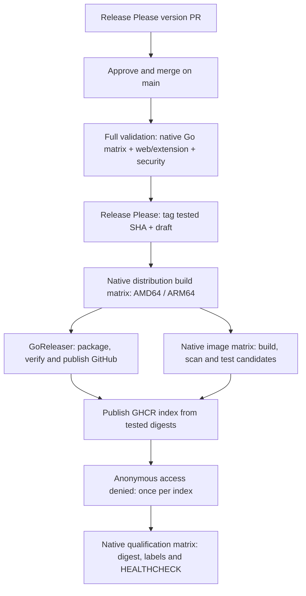

# Release and image qualification

Start with the [development and merge policy](CI.md#development-and-merge-policy). Publishing a version requires an explicit request.

## Rehearse packaging locally

Release tooling uses **GoReleaser OSS 2.18.3**, pinned in Actions. No Pro license or additional secret is required. Linux binaries require `musl-gcc` and matching native architecture because SQLite uses CGO. The native release jobs compile and smoke-check them after validation and tagging; GoReleaser's OSS `meta` archives then package those exact binaries with installation instructions. It generates the extension ZIPs and `SHA256SUMS` too. The single extension ZIP contains fourteen explicitly named production files, including its background worker, and declares `debugger` access. Tests and local data are never globbed into release archives.

For a local packaging rehearsal, download the `linux-amd64` and `linux-arm64` Release artifacts into `artifacts/linux-amd64/` and `artifacts/linux-arm64/`, retaining their executable and `.buildinfo.txt` files. With GoReleaser 2.18.3 installed, run:

```sh
make release-snapshot
python3 scripts/verify_release.py --directory dist --metadata artifacts \
  --commit "$(git rev-parse HEAD)" --output artifacts/verified
```

Use artifacts built from the current clean commit; verification rejects another revision. The output directory must be new. `artifacts/verified/` contains only the six approved assets, separate from GoReleaser's temporary metadata in `dist/`.

## Publish a version

1. Release Please updates the version PR and changelog on ordinary main pushes.
   Its action uses `skip-github-release: true`; no tag is created at this stage.
   The workflow explicitly dispatches CI on the bot-created PR branch.
2. Approve and merge the version PR when publication is intended. The release
   workflow uses the native `pull_request: closed` event and checks its merged
   state, repository and Release Please label. The event supplies the PR number
   and merge SHA without a commit-to-PR API lookup. It calls `ci.yml` at that
   immutable revision. Ordinary pushes only maintain the next version PR.
3. After all validation jobs succeed, Release Please CLI 17.3.0 creates the stable
   tag and GitHub draft. Its native comma-separated label filter includes a
   temporary SHA-specific validation label, so a concurrently merged version PR
   cannot be tagged by this run. Release Please handles notes and label state;
   GitHub CLI never creates release tags. The temporary label is deleted after
   successful creation. Existing tags must resolve to the tested commit.
4. Native AMD64/ARM64 jobs build static CGO executables with musl. They check the
   executable, embedded source revision, architecture and SQLite settings before
   uploading same-run artifacts. No polling, lookup of previous CI runs or
   long-lived main binary inventory is needed.
5. Two branches proceed in parallel: GoReleaser packages and uploads GitHub draft
   assets, while native Docker jobs build, scan and test candidates from those
   same executables. One `.goreleaser.yaml` supplies all packaging. Archive and
   checksum verification must pass before the draft is published.
6. GHCR publication waits for both image candidates and GitHub publication. The
   version index contains only the two tested digests. Anonymous access denial is
   checked once for that index. Native qualification then checks the actual tag,
   platform, source/version labels and Docker HEALTHCHECK on both architectures;
   it does not repeat the candidate's full application journeys.

One native concurrency group with `queue: max` serializes release runs while
retaining up to 100 pending executions; jobs inside each run remain parallel.
The SHA-specific Release Please label filter is still needed because queueing
workflows does not prevent additional PRs from being merged. Actionlint 1.7.12
and upstream currently lack the `queue` key: the lint invocation ignores only
that unknown-key diagnostic, leaving all other workflow checks enabled. The
workflow uses a literal `queue: max` and `cancel-in-progress: false`.


GoReleaser stays OSS; it does not rebuild the native executables. Expected assets
are two Linux archives, two build metadata files, the extension ZIP and
`SHA256SUMS`. Binary/archive and image evidence is retained for seven days.

Tests compile temporary binaries and frontend assets before tagging; distribution
builds happen after tagging. A validation failure leaves no tag. A later failure
can leave an immutable tag, a draft, untagged image candidates, or an already
published GitHub release. GitHub and GHCR publication are not one transaction.
Partial uploads to a draft must be inspected and removed before retrying; the
workflow refuses to overwrite a non-empty draft or a published release.

## Verification and recovery

Manual Release dispatch defaults to a dry run: validation, native builds and
snapshot packaging, without tagging, publishing or building container candidates.
An optional existing stable tag selects its original source revision. All source
revisions must belong to main.

To resume an existing tag after validation succeeds:

```sh
gh workflow run release.yml --ref main -f tag=v1.3.3 -F publish=true
```

No tag event or `release:published` event is needed: dependent jobs run in the same
workflow, avoiding `GITHUB_TOKEN` event suppression. Existing tags are never moved.
When GitHub publication already succeeded, recovery downloads and verifies its
original binary archives instead of rebuilding different application bytes, skips
GitHub upload, and retries image publication. A registry version containing other
platform digests is rejected. Snapshot verification still assembles a bundle even
when the selected tag is already published.

## GHCR images

The existing Dockerfile's `BINARY_SOURCE=prebuilt` path copies the validated
executable into the runtime stage; it does not run a compiler. Native image jobs
push untagged candidate digests, generate CycloneDX inventories with Syft 1.55.0,
and scan with Grype 0.121.0. High/critical findings block even without a fix.
Compose tests cover authentication, FTS5, SSRF rejection, backup and restart
persistence; Chromium journeys run once on AMD64. Build attestations remain
disabled so the index contains exactly two runnable platforms; this pipeline does
not claim signed provenance or complete identification of statically embedded C.

The index publishes only `vMAJOR.MINOR.PATCH`, with no moving aliases. Existing
version tags must already contain the same tested digests. Authorization and
network failures are never treated as permission to replace an index. Published
qualification checks the registry and pulled digest, platform, source/version
labels and an isolated, read-only container's native HEALTHCHECK. The privacy
check runs once at index level; standalone qualification checks privacy by default.
GHCR remains private and
requires authenticated pulls. Workflows publish artifacts; server deployment
remains manual.

### Development and publication flow


