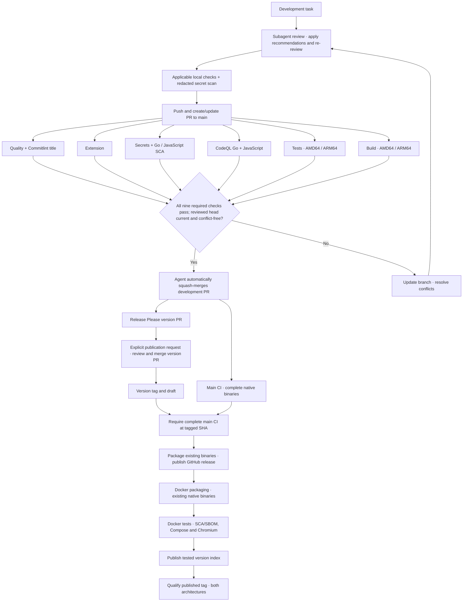

# Release and image qualification

Start with the [development and merge policy](CI.md#development-and-merge-policy). Publishing a version requires an explicit request.

## Rehearse packaging locally

Release tooling uses **GoReleaser OSS 2.18.3**, pinned in Actions. No Pro license or additional secret is required. Linux binaries require `musl-gcc` and matching native architecture because SQLite uses CGO. The native CI jobs compile and test them; GoReleaser's OSS `meta` archives then package those exact binaries with installation instructions. It generates the extension ZIPs and `SHA256SUMS` too. The single extension ZIP contains fourteen explicitly named production files, including its background worker, and declares `debugger` access. Tests and local data are never globbed into release archives.

For a local packaging rehearsal, download the `linux-amd64` and `linux-arm64` CI artifacts into `artifacts/linux-amd64/` and `artifacts/linux-arm64/`, retaining their executable and `.buildinfo.txt` files. With GoReleaser 2.18.3 installed, run:

```sh
make release-snapshot
python3 scripts/verify_release.py --directory dist --metadata artifacts \
  --commit "$(git rev-parse HEAD)" --output artifacts/verified
goreleaser release --snapshot --skip=archive --clean --config .goreleaser-publish.yaml
```

Use artifacts built from the current clean commit; verification rejects another revision. The output directory must be new. `artifacts/verified/` contains only the six approved assets, separate from GoReleaser's temporary metadata in `dist/`.

## Publish a version

The normal release entry point is **merging the Release Please version PR**. On each push to `main`, Release Please reads Conventional Commits and opens or updates a PR containing `CHANGELOG.md`, `version.txt` and `.release-please-manifest.json`. `feat:` requests a minor bump, `fix:` a patch bump, and `!` or a `BREAKING CHANGE:` footer a major bump. Commits such as `docs:` and `ci:` alone do not request a release. With no previous published tags/releases, the first version is `0.1.0`. The Chrome extension keeps its independent manifest version.

Review and squash-merge the version PR when ready to publish; keep its generated title and release metadata. Release Please creates an immutable `vMAJOR.MINOR.PATCH` tag and a **draft** GitHub release. The remaining jobs run directly in the same Release workflow: they do not rely on the tag/release events suppressed by `GITHUB_TOKEN`. The workflow validates the tag and ancestry, waits for the entire main CI run at that exact commit (including the separate test and build jobs), downloads that run’s tested executables with digest validation, and runs `.goreleaser.yaml` to package them. It accepts neither PR CI nor an incomplete main run. Release packaging reuses the downloaded binaries without rebuilding them; the container workflow builds Docker separately after GitHub publication. Verification checks checksums, archive contents, executable permissions, ELF architecture, clean source revision and extension permissions before retaining the publication bundle.

Only then does the write-enabled job recheck that bundle and require a missing release or an empty stable draft targeting the verified commit. It runs `.goreleaser-publish.yaml` to upload those same files and publish the release, retaining Release Please's notes. This separate configuration disables builds and checksums; `--skip=archive` also prevents repackaging. GitHub assets are not rebuilt during publication, tags are not moved and published releases are not overwritten. After GitHub publication succeeds, the workflow calls the container workflow below. An explicitly requested manual tag push still follows the same validation/publication path.

Enable **Settings → Actions → General → Workflow permissions → Allow GitHub Actions to create and approve pull requests** for Release Please to open its version PRs. The workflow never approves or merges PRs. The Release Please job explicitly dispatches the single read-only CI workflow on the PR branch after creating/updating it. This avoids depending on automatic PR-event execution or an approval-required bot run; `workflow_dispatch` is an explicit exception to the usual `GITHUB_TOKEN` event restrictions ([GitHub documentation](https://docs.github.com/en/actions/how-tos/write-workflows/choose-when-workflows-run/trigger-a-workflow)). These checks run at the PR head revision and satisfy the normal CI requirement without a PAT.

If verification fails, the release stays a draft and the container is not published. Rerun the failed jobs after resolving the failure. If the workflow itself needed a fix, use the corrected workflow to resume the existing immutable tag:

```sh
gh workflow run release.yml --repo theopoc/pocketmark --ref main -f tag=v0.1.0 -F publish=true
```

This rechecks the successful main CI and packages its retained artifacts at the tag’s exact revision before publishing. It does not move the tag or package the corrected workflow's current source. To rehearse that recovery without publication, omit `publish=true`. If publication partially uploaded files, inspect and remove those draft assets before retrying; the guard deliberately rejects non-empty drafts. For a failure after GitHub publication, rerun the container jobs or use the backfill dispatch below.

Expected assets are Linux AMD64/ARM64 `.tar.gz` files, their `.buildinfo.txt` files, the Chrome extension ZIP, and `SHA256SUMS`. Binary archives are static; extensions are unpacked/loaded manually. [Binary installation instructions](RELEASE_INSTALL.md).

Manually dispatching **Release** defaults to complete verification and assembly as a **dry run**, on a commit belonging to `main`. Both GoReleaser configurations are exercised in snapshot mode, which disables publication. Its `verified-release` artifact contains the same asset set and checksums. GitHub and container publication stay skipped even when a manual run targets a tag, unless the explicit `publish` input is enabled with a stable tag. No product version is published merely by committing or pushing `main`.

## GHCR images

A **version image** is identified by a stable product version and its source revision. **Published-image qualification** verifies the published content, revision and platform, exercises the supported runtime configuration on each platform and checks that the image remains private.

Docker builds occur only in `container-release.yml`, after GitHub release publication or an explicit retry for an already published stable release. The workflow validates the immutable tag, ancestry on main and successful complete main CI with retained binaries. Ordinary main pushes, PRs, the weekly CI and release dry runs never build Docker.

The release image flow has separate build and test phases. Prepare identifies the
successful main run; each build downloads that run's native artifact with digest
validation. `scripts/prepare_image.py` verifies the actual ELF architecture, absence
of a dynamic interpreter, embedded Go build metadata, clean revision, CGO and
SQLite tags against the accompanying metadata. It copies the executable unchanged
into a new minimal context with the single `Dockerfile`. The release build selects
`BINARY_SOURCE=prebuilt` and the final `runtime` target; BuildKit skips the source
compilation stage, so no compiler runs in the image build. The runtime recipe comes
from the executing workflow revision, including
manual recovery of older releases. The application bytes always come from the
validated release revision. A plain `docker build -t pocketmark:local .` uses
`BINARY_SOURCE=build` by default, compiling sources with a Go baseline matching
`go.mod` and packaging them in the same final runtime stage. Both paths require
BuildKit, which only builds the selected dependencies.

A local rehearsal with an extracted native CI artifact in `/tmp/image-input`:

```sh
python3 scripts/prepare_image.py --directory /tmp/image-input --arch amd64 \
  --revision <validated-source-sha> --output /tmp/pocketmark-image-context
docker build --build-arg BINARY_SOURCE=prebuilt --target runtime \
  -t pocketmark:ci-release /tmp/pocketmark-image-context
python3 scripts/smoke_docker.py --image pocketmark:ci-release
```

The shared runtime stage defines the user, healthcheck and memory settings for both build paths. Native AMD64/ARM64 builders push untagged candidate digests. Fresh native test jobs pull those exact digests and run hardened Compose smoke tests plus Chromium journeys. Only when both pass does publication create `vMAJOR.MINOR.PATCH` from those tested digests. The published tag is then pulled and qualified on both architectures: exact index digest, platform, source revision, version label, health/authentication, FTS5, SSRF filtering, backup, restart persistence and anonymous-access denial. No `latest` or moving minor alias is published.

The OCI revision is the release source SHA and the OCI version is `vMAJOR.MINOR.PATCH`. Images are built once per release attempt; no SHA-tag promotion or image evidence from main CI is involved. Existing version tags must already contain the same platform digests; differing content is never replaced. A retry that produces different bytes therefore fails safely instead of overwriting an existing version.

Main binaries are retained for 90 days, subject to repository retention policy. Missing/expired binaries or a failed main CI block publication rather than silently rebuilding release archives. Rerun the original main CI for recoverable failures. Build attestations remain disabled so the index contains exactly two runnable platforms; this pipeline does not claim signed provenance. Syft 1.55.0 generates a CycloneDX SBOM for each candidate image, and Grype 0.121.0 scans it before the version index can be published. High/critical findings block, including findings without a fix. SBOMs and scan results are retained with container-test evidence for seven days. Image inventory covers detected OS and language packages; statically embedded C code is not guaranteed to be identified. Untagged candidates may remain after a failed release attempt.

GHCR package visibility is separate from the public source repository and must remain private; consumers need authenticated read access. These workflows publish artifacts and do not deploy to a server. Release calls the container workflow directly because publication using `GITHUB_TOKEN` does not trigger another workflow's `release:published` event. [GitHub event semantics](https://docs.github.com/en/actions/how-tos/write-workflows/choose-when-workflows-run/trigger-a-workflow).

To retry the container workflow for an already published release without moving its Git tag or changing its GitHub assets:

```sh
gh workflow run container-release.yml --repo theopoc/pocketmark --ref main -f tag=v0.3.0
```

This dispatch builds and tests real release candidates and can publish the version image; it is not a dry run. Authenticated clients can then pull it:

```sh
docker pull ghcr.io/theopoc/pocketmark:v0.3.0
```

### Development and publication flow


