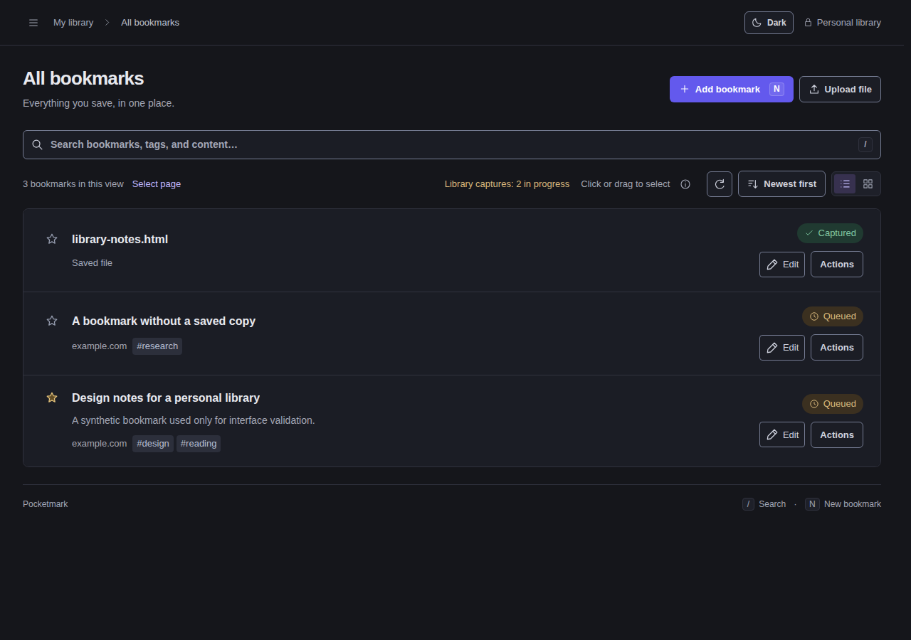
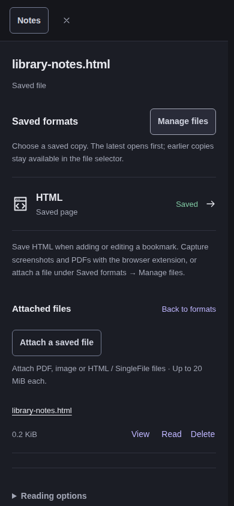
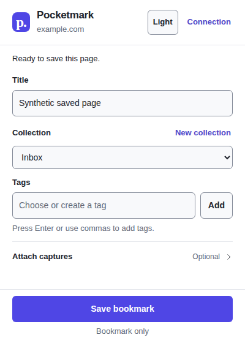

# Interface completion evidence — 31 October 2026

This pass completes the eight remaining topics from the interface audit after
PR #101. It preserves saved formats as the first bookmark destination, the
existing library and the single Go/SQLite process. No new application framework,
remote asset, server cache or background service is introduced.

## Acceptance map

| Audit topic | Result | Evidence |
| --- | --- | --- |
| Motion throughout the app | Shared short durations, interruption-safe theme changes, reduced-motion fallback, stable scrollbar gutter | Delayed-snapshot rapid-toggle regression; three-engine opening/idle sample below |
| Consistent colors and control states | One paired semantic palette for app, login/MFA, docs and extension; matching hover, focus, disabled, selected, error and success states | Both themes in the accessibility matrix; shared-asset drift check |
| Type and spacing | Shared 12/13/14/16px scale and spacing tokens; clearer labels, headings and field boundaries | Desktop, phone portrait and landscape screenshots/layout assertions |
| Named desktop actions | Visible Edit and named Actions disclosure; panel chooses above/below without expanding a list row; outside interaction and Escape close it | Keyboard failure/cancel focus regressions; existing selection/delete journeys |
| Direct file management | Manage files beside Saved formats; files independent of Notes/Highlights; Read reveals and focuses the saved document | Reader regressions, three-engine phone workflow |
| Secondary surfaces | Login, MFA, help, API docs and extension use shared states and typography; extension gains both themes | All surfaces audited; five popup states per theme through an adapter |
| Unicode collection limits | Live character count and percentage of the actual 120-byte UTF-8 name budget, with native validation | ASCII, accented and emoji boundary tests; invalid/cancel extension regression |
| Broader UI validation | Chromium, Firefox and WebKit checks, keyboard focus, emulated touch, both themes, narrow and landscape layouts | Bounded matrix described below; physical devices and spoken assistive technology remain outside this evidence |

## Findings corrected during validation

Automated accessibility checks exposed mismatched visible/accessibility labels
on theme and saved-format controls, a low-contrast extension text button and an
unlabelled API server selector. These were fixed without suppressing axe rules.
Independent review then found interactions that an axe scan cannot establish:
rapid theme toggles could lose the last request; closing a secondary action
could lose keyboard focus; reading an attachment left its document below the
open file manager; cancelling an invalid extension collection could prevent
bookmark submission. Focus, theme and form-state regressions now cover those
cases. Cancelled bookmark deletion also returns to its visible Actions trigger.

Direct settings headings also reserve scroll space so their focus outline stays
inside the viewport rather than clipping at a rounded scroll boundary.

The full browser journey initially clicked the reserved scrollbar gutter rather
than the navigation backdrop. The coordinate checks now wait for the entrance
and target the middle of the actual outside band. Ordinary backdrop dismissal
was confirmed in the browser; its cancellation/drag guards are preserved.

## Executed matrix

`e2e/polish.mjs` uses disposable loopback data and profiles. The 31 October run
used Chromium 156.0.8078.79, Firefox 157.0 and WebKit 27.2. It checked 82 surface
and theme combinations with axe-core 4.14.0 against WCAG 2 A/AA, 2.1 A/AA and
2.2 AA tags, with zero detected violations and no disabled rules:

- Library, bookmark editor, attached files, Notes, four settings destinations,
  help, API docs, login and MFA challenge in both themes on each engine.
- Extension connection, editor, failed capture, saving and completed states in
  both themes on Chromium with a bounded Chrome API adapter.
- Editor layout at 1280×900, 390×844, 320×568 and 844×390: no horizontal document
  overflow and visible Save action. Phone file reading returns focus to the
  visible structured document. Emulated touch opens and cancels the editor on
  all three engines. Keyboard checks exercise action failure, Escape and
  cancelled deletion.

The adapter checks the shipped popup assets, not the native action popup or
capture worker. Previous real-extension observations remain in
[REAL_CLIENTS.md](REAL_CLIENTS.md). The complete existing Chromium end-to-end
journey separately covers real HTTP/SQLite behavior, native PDF viewing,
selection, reader, settings, authentication and MFA recovery.

A local headless sample compared 400ms idle against a 700ms dialog opening:

| Engine | Idle maximum / frames over 50ms | Opening maximum / frames over 50ms |
| --- | --- | --- |
| Chromium | 17ms / 0 | 17ms / 0 |
| Firefox | 17ms / 0 | 17ms / 0 |
| WebKit | 17ms / 0 | 70ms / 1 |

The WebKit opening includes one slow frame. This small local observation is
not a frame-rate guarantee, a device benchmark or proof of uniformly smooth
motion. Reduced motion makes overlay state changes immediate; color feedback
remains brief. No physical phone, on-screen keyboard, spoken screen reader or
Safari installation was tested. Automated accessibility scans and WebKit UI
coverage do not establish complete accessibility or Safari compatibility.

## Reproduction

Install the test-only dependencies with `npm ci --prefix e2e`, then install
Playwright Firefox/WebKit and their host libraries. Build Pocketmark and start
a new disposable loopback instance, with adequate test rate limits. Never use
a personal database or browser profile.

```sh
E2E_BASE_URL=http://127.0.0.1:8093 \
E2E_EVIDENCE_DIR=/tmp/pocketmark-ui-evidence \
E2E_FIXTURE_FILE=/tmp/pocketmark-ui-fixture.json \
E2E_CHROMIUM_EXECUTABLE=/usr/bin/google-chrome \
node e2e/polish.mjs
```

The optional fixture file holds disposable credentials/session data, belongs to
that exact instance and must stay outside commits. Remove it when replacing the
instance. Without it the script expects a fresh database. The output directory
contains screenshots and a structured report; retain only curated synthetic
screenshots in the repository. `E2E_ENGINES=chromium` narrows development runs.
Axe is an exact-pinned test dependency and is never served or embedded in the
application or extension package.

Required local checks are `make check`, `make test`, `make test-extension` and
`make build`; extension packaging also has `python3 -m unittest
scripts/test_package_extension.py`. `python3 scripts/sync_ui_assets.py` rejects
drift between the app's canonical tokens/name-limit/theme-switch modules and
the extension's packaged local copies; `--write` refreshes those copies.

## Curated synthetic views






