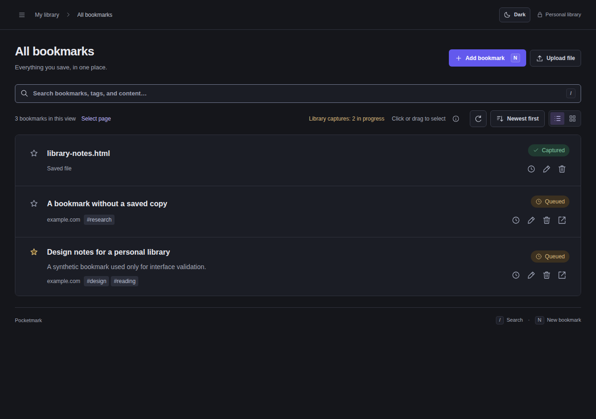
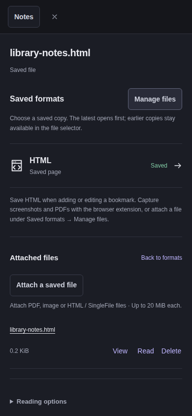
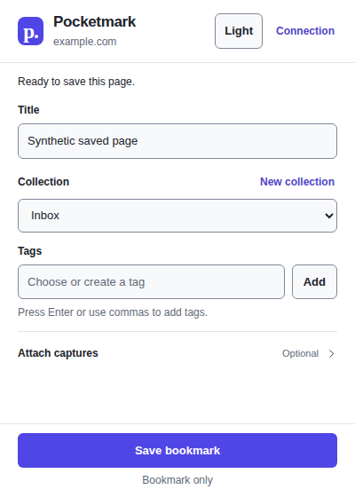

# UI validation report — 1 November 2026

This is a historical report of the scope delivered and checks performed on this
date. Current interface design rules live in [DESIGN.md](../DESIGN.md); this
report does not define additional rules or establish validation of later changes.

The user approved nine separate lots after reverting PR #102, with an explicit
requirement to keep the current bookmark actions and sort design. The visual
reference is `e678b74`, whose tree equals the pre-#102 interface (`793b220`).

## Delivered scope

The delivered change preserved `internal/webui/static/style.css`, bookmark and
sort markup/handlers, and library row/grid geometry. It added scoped secondary
styles and an extension light theme alongside the existing dark palette.
It changed no library data, storage migration, authentication policy, capture
permission or server architecture, and introduced no production dependency or
resident service.

## Approval ledger

| Approved lot | Implementation | Verification | Status |
| --- | --- | --- | --- |
| 1. Reliable theme switching | Shared interruption-safe controller for app, API docs and extension; correct accessible theme label | Delayed snapshot/rapid-toggle and storage-denied regressions | Verified |
| 2. Settings keyboard focus | 16px heading scroll margin on the settings page | Direct 2FA destination at 1280×720, title focused and inside viewport | Verified |
| 3. Collection counter | Character count, percentage of 120-byte UTF-8 budget, immediate native validation in app/extension; cancelled extension draft cannot block save | ASCII/accent/emoji boundaries, both-theme collection/cancel workflows | Verified |
| 4. Direct file management | Manage files beside Saved formats; Notes/Highlights stay in Notes; Back to formats; Read reveals/focuses the document | Reader unit regressions and phone journey on each engine | Verified |
| 5. Complementary motion | 160ms notebook/file/help/extension opacity feedback, progressive fallback and reduced-motion override | Opening/dismissal, reduced-motion and local frame samples | Verified |
| 6. Secondary control states | Scoped hover/focus/disabled/error colors on login/MFA, settings, help and API docs (including the API server accessible label); extension retains its palette with paired light states | Both-theme audits and visual inspection | Verified |
| 7. Secondary readability | 13px labels/hints, 14px body copy, field/help/error spacing; phone fields 16px | Desktop/phone/landscape layouts and fixed Save visibility | Verified |
| 8. Light extension theme | Header Dark/Light toggle and local preference; field order/capture options/footer preserved | Five popup states in both themes with a bounded Chrome API adapter | Verified |
| 9. Validation report | Disposable browser matrix, fidelity comparison and this ledger | Results below; findings outside approval are reported separately | Verified |

## Fidelity comparison

`e2e/fidelity.mjs` records and compares the same Chromium version, disposable
fixture, viewport, theme, view and interaction state. The final reference binary
was built separately from `1c21ea3` (its UI is identical to `e678b74`); no modified
UI is used as a reference. Brief control feedback and paint layers settle before
capture.

All 236 native screenshots of the protected action/favorite controls and sort
button/menu match byte for byte, across 32 states: light/dark, widths
1280/390/320, list/grid, sorting open/closed and existing mobile Actions
expanded/collapsed. Library geometry and computed typography/colors/borders
also match exactly in every state. No pixel tolerance or masking is used for
those controls.

Thirty whole-library frames also match byte for byte. Two dark desktop list
frames retain tiny differences at the outer rounded borders: respectively 11
and 3 pixels, at most one RGB level, outside the protected controls. These are
consistent with rasterization differences; they are retained and disclosed
rather than masked. An accessibility scan alone would not establish fidelity.

## Validation results

The sequential browser matrix completed 82 surface/theme audits with zero
detected axe violations (WCAG 2 A/AA, 2.1 A/AA and 2.2 AA tags, no disabled
rules): Chromium 156.0.8078.79, Firefox 157.0 and WebKit 27.2. It exercises the
library, editor, files, notes, four settings destinations, help, API docs, login
and MFA in both themes, plus five extension states per theme through an adapter.
It checks 320px portrait and phone landscape editor layouts, direct settings
focus, emulated touch and collection cancellation. An explicit rendered
`color-scheme` assertion protects the extension light theme as well as its label.

A 400ms idle / 700ms existing-editor-opening sample recorded 17ms maximum idle
frames on all three engines. Opening maxima were 17ms in Chromium and Firefox
and 69ms in WebKit (one frame over 50ms). This is a local headless observation
of the existing dialog, not proof of uniformly smooth new animations or device
performance. Disclosure fades progressively enhance native behavior. On each engine, the
notebook reports 160ms normally and 0ms with reduced motion; the extension
disclosure also reports zero transition time with reduced motion.

`make check`, `make test` (Go race suite and 92 UI tests),
`make test-extension` (47 tests), `make build` and the extension-package
regression passed. The full Chromium HTTP/SQLite journey passed, including
CRUD/search, drafts, selection, settings, MFA/recovery, HTML/image/PDF previews
and isolation. Local checks were run serially; Go work used `GOMAXPROCS=2` and
`GOFLAGS=-p=1`.

Independent review caught an undefined Help hover color and missing shared
scripts in the release extension archive. Both were corrected. A regression
now compares the manual, GoReleaser and verifier allowlists and checks the
popup's actual script/style references. All 47 Python tooling tests and both
GoReleaser configuration checks pass. An extension-only GoReleaser snapshot,
using the extension archive block from the production configuration, produced
exactly 12 files, each byte-identical to its source. This is packaging evidence,
not a publication or a new native extension runtime qualification.

No physical phone, on-screen keyboard or spoken screen reader is available.
Playwright WebKit is not qualification of Safari. Extension adapter coverage
checks the shipped UI assets, not a fresh native-popup/worker qualification.
Previous real-client observations retain their dated scope in
[REAL_CLIENTS.md](REAL_CLIENTS.md).

## Reproduction

Install test-only dependencies using `npm ci --prefix e2e`; install the
Playwright engines and host libraries. Use a fresh disposable loopback instance
and adequate test rate limits. Run each command separately and keep only one
browser engine or Go suite active at a time on a constrained laptop.

```sh
E2E_BASE_URL=http://127.0.0.1:8093 \
E2E_EVIDENCE_DIR=/tmp/pocketmark-approved-evidence \
E2E_FIXTURE_FILE=/tmp/pocketmark-ui-fixture.json \
E2E_CHROMIUM_EXECUTABLE=/usr/bin/google-chrome node e2e/polish.mjs
```

The optional fixture is tied to that exact disposable instance and holds test
credentials/session state. Keep it and raw browser evidence outside commits.
`E2E_ENGINES=chromium` narrows a development run. Axe is pinned in test tooling
only, never embedded in the UI or packaged extension.

For the protected library, run `e2e/fidelity.mjs` with `E2E_FIXTURE_FILE`,
`E2E_EVIDENCE_DIR` and optionally `E2E_CHROMIUM_EXECUTABLE`. Record on the base
revision, then set `E2E_REFERENCE_DIR` to that directory on this revision and
choose a separate output directory. Use the same browser and fixture for both.
Do not overwrite the reference with the changed UI.


## Curated synthetic views






